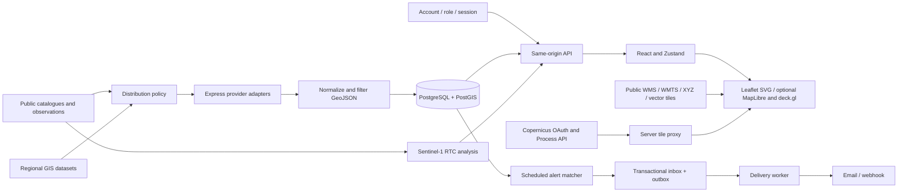

# GulfHazard Monitor

A bilingual GIS workspace for the Arabian Peninsula and adjoining seas. Explore earthquake catalogues, satellite detections, forecasts and regional inventories within 32–60° E and 12–33° N. The opening view uses local reference geography and three enabled observation layers. Each layer shows its source, acquisition time or inventory edition, coverage and retrieval status.

[خطوات التشغيل بالعربي، الحسابات والنشر](docs/operations.md) · [Flood validation and documented earthquake damage](docs/flood-validation.md)

## Run locally

Use Node.js **24 LTS** and npm. Open a terminal at the repository root.

```sh
npm ci
npm run build
npm start
```

Open **http://127.0.0.1:5173**. The production server serves the compiled frontend from `frontend/dist/`. Recent NOAA-20 thermal detections, USGS earthquakes, work without keys. The research edition also includes the public Cerulean collection. The default Leaflet map renders regional geography and hazard symbols with SVG and supports mouse-wheel zoom and drag-to-pan. The optional vector streets view uses WebGL 2. The Node process needs HTTPS access to the selected providers.

For development, run `npm run dev`. To rebuild and validate a change, run `npm test` and `npm run build`. Run `npm run dev:backend` and `npm run dev:frontend` in separate terminals at the repository root for independent development. The frontend runs on port 5173 and proxies `/api` to port 5174. The backend reads the root `.env`. To change the API port, set `API_PORT` for the backend and `API_PROXY_TARGET` in the frontend terminal. Development and production share the Express API. Run one of these servers on a given port.

With the server running, `npm run test:map` checks the map with WebGL disabled and external tiles blocked. It exercises country outlines, hazard clusters, wheel zoom, dragging, event selection and PNG export using the bundled dated observations. It uses installed Chrome or the Chromium executable specified by `CHROME_PATH`.

On Windows, use `if (!(Test-Path .env)) { Copy-Item .env.example .env }` in PowerShell to configure optional providers. On macOS or Linux use `test -f .env || cp .env.example .env`. Restart the server after changing the file.

## Workspace

- **Whole Arabian Gulf** selects Bahrain, Iraq, Iran, Kuwait, Oman, Qatar, Saudi Arabia, the UAE and Gulf waters. **GCC countries** selects the six member states. Both presets leave other selections intact. Offshore observations can also be isolated using **Waters**.

- Open **Places** in the checkpoint bar and search in English or Arabic. Select any combination of countries, administrative regions and towns. A record intersecting any selection appears once in the map, feed, timeline and active-layer counts. **Show on map** fits the selected areas. **Clear all** restores the full monitoring area. Saved projects keep their place selections.
- Country and region selections use the bundled Natural Earth land polygons. City selections use a 25 km radius around the mapped centre. Selecting a place outside the monitored extent (32–60° E, 12–33° N) does not expand upstream feed coverage.

- Tick checkpoint boxes to combine layers. The chevron opens opacity, date, threshold and legend settings. Additional layers and their settings are under **More layers**.
- The default timeline covers the rolling seven days. Choose **24H**, **7D**, **30D**, **1Y**, or enter a UTC range with the clock tool. Playback advances the cutoff for event layers. Model editions and inventories retain their reference dates.
- The **Hazard feed** supports ordering, layer filters and map selection. It groups FIRMS pixels by satellite, country and UTC hour to keep individual overpasses readable. Selecting a group opens its representative detection. The active settings determine which observations are included in the map and exports. Compare numeric values within a single layer because units differ.
- **Compare** has an independent sensor and target UTC day on each side. Choose a same-day mosaic, MODIS Terra or Aqua, VIIRS NOAA-20 or Suomi NPP, Sentinel-1 radar, Sentinel-2 optical, or Landsat 8/9. Scene searches cover the map centre and can look back seven days. Each matched scene links to the original acquisition with its actual date. Hazard indicators start enabled and show the same records from the active monitor filters on both sides. Use their checkbox for an imagery-only view.
- Drag the divider or its handle to reveal either image. Drag elsewhere to pan both dates together. Keyboard controls support the arrows, Shift + arrow for 10% steps, and Home or End. Each side reports its own catalogue and tile status. The regional renderer also samples tile transparency to indicate gaps in the map view.
- The satellite tool also provides daily imagery, model products, and scene lookup near the map centre. **View SAR scene** requests the exact Sentinel‑1 product associated with a Cerulean polygon.
- Search regional English or Arabic place names or enter **latitude, longitude**. Selecting a settlement opens a town-scale view. Local labels include 7,301 additional GeoNames settlements and appear progressively as you zoom. Projects save the camera, layer settings, dates and AOI to the current browser.
- Draw a polygon by clicking vertices and choosing **Finish drawing**. Rectangles and circles use two clicks. The AOI results include counts, maximum layer values and daily totals. Point-in-polygon and polygon overlaps both contribute. A buffer expands the AOI by the supplied distance. Measure reports geodesic kilometres or square kilometres.
- Export the intersection of active features with the map viewport and optional AOI as GeoJSON, CSV or a zipped Shapefile. Exports retain the full selected geometries. PNG/PDF captures map content, labels and credits. Allow the selected imagery tiles to render before exporting.
- **Regional exposure** compares the number of days with USGS earthquakes of M ≥ 4 within 25 km against equal-length periods in the regional 2015–2024 catalogue. An alternative view reports the share of days with any selected hazard. A separate NOAA panel supplies historical, assessed damage records and chronological holdout results.
- Statistics count earthquakes by month, dissolve overlapping slick footprints within each year, and count distinct one-kilometre thermal cell-days by country. The default industrial filter excludes FIRMS static-source flags and, in research mode, detections within 1 km of known EOG flare sites. Change it in Fires settings. Cell-days and unique annual footprints describe observed activity and area.

## Satellite imagery

In the satellite viewer, choose **Auto · best available detail**, a target UTC date and a scene search window, then **Load imagery**. Pan or zoom to update the selection at the map centre. The overview checks same-day VIIRS NOAA-20 reflectance. For screen resolutions between 32 and 200 metres per pixel, the app prefers Landsat 8/9 RGB (30 m). At finer scales it prefers Sentinel-2 RGB (10 m). Zooming beyond a sensor's sampling limit enlarges its existing pixels. For street-level reference, the satellite basemap uses Esri's multi-date mosaic.

For optical scenes, search the target day or allow acquisitions up to 7 or 30 days earlier. The search uses the actual map point, filters Landsat to platforms 8/9, prefers recent scenes with no more than 60% scene-wide cloud cover when possible, and checks rendered pixels at the focus point. Cloud cover for a whole scene cannot establish cloud conditions over an individual town. The viewer reports the acquisition date, source and resolution. Auto tries the second optical sensor and then a regional daily image if neither detailed source is usable. A provider outage and an empty search have different statuses. Manually selected science products and exact SAR scenes keep their selected instrument and date.

Before loading a manually chosen daily true-colour layer, the viewer checks the date intervals in NASA's WMTS catalogue. An unpublished day shows the most recent published day on or before the target.

Daily MODIS uses NASA's daytime Data/No Data mask for each platform. The default **MODIS + VIIRS** comparison keeps observed Terra pixels, fills empty pixels with Aqua, then uses positive reflectance from NOAA-20 in remaining gaps. All contributing observations come from the selected UTC day. Different overpass times can create visible boundaries, especially over moving clouds. The **Terra + Aqua** option uses only those two passes. Single-platform MODIS preserves each original footprint. Remaining gaps show the basemap. [NASA mask legend](https://gibs.earthdata.nasa.gov/colormaps/v1.3/MODIS_Data_No_Data.xml) · [NASA Worldview coverage guide](https://earthdata.nasa.gov/s3fs-public/2025-03/worldview-booklet.pdf)

## Architecture



The server validates calendar dates, restricts observations to the study region, normalizes provider units and preserves observation timestamps. Each feature carries `id`, `type`, GeoJSON geometry, `severity`, `timestamp`, `source`, `source_url` and `confidence`. Unknown values are null. Severity units are layer-specific. GeoJSON uses WGS 84 longitude/latitude. Both renderers display Web Mercator and Turf performs geographic intersections, buffers and measurements.

The cache key includes the deployment profile, layer and requested dates. Concurrent identical fetches share a request. Failed HTTP calls receive a bounded retry for transient failures. Responses distinguish current, empty, partially covered, cached, refreshing, unavailable and unconfigured sources. A successful empty response replaces old detections for that query. Dated captures can supply overlapping records during an outage. Their original fetch time and coverage travel with the response. Failed calls never advance the successful-fetch timestamp.

### Source tree

```text
frontend/src/gis/     Leaflet and MapLibre renderers, place filters, drawing and map capture
frontend/src/         React UI, map styles, bilingual controls and exports
backend/              Express API, provider adapters, PostGIS storage, accounts, provider health and outbox jobs
backend/tests/         Data integrity, normalization, cache and alert validation
shared/               Layer definitions, units, licenses and provider cadence
gis/public/cartography/   Regional land, boundaries, water, labels and DEM shading
gis/public/fonts/         Local typeface, map glyphs and font licenses
datasets/             Dated provider captures and licensed regional datasets
frontend/dist/        Compiled frontend
.env.example          Server-side configuration checklist
```

### API examples

| Request | Result |
| --- | --- |
| `GET /api/health` | Server availability and UTC time |
| `GET /api/health/providers` | HTTP 503 if any queried provider is down or priority polling is overdue |
| `GET /api/radar?mode=change&lon=43.14&lat=15.18&before=2024-07-26&date=2024-08-10` | Two compatible RTC acquisitions, bounds, classified pixels and PNG overlay |
| `GET /api/catalog` | Layer catalog, available notification channels and Copernicus configuration status |
| `GET /api/layers/earthquakes?start=2026-11-01&end=2026-11-07` | Normalized FeatureCollection, status, coverage, provider and last success |
| `GET /api/slick/{numeric-id}/origin` | Candidate origin classes from Cerulean |
| `GET /api/imagery/auto?band=fine&date=2026-11-23&lon=45.251&lat=25.24&lookback=30` | Actual acquisition, tile service, native resolution and selection reason at the map centre |
| `GET /api/imagery/dates?product=true&date=2026-11-23` | Publication status and latest available day up to the requested date |
| `GET /api/modis/{date}/{z}/{x}/{y}.png` | True-colour Terra imagery with transparent no-data pixels |
| `GET /api/volcano/{volcano-number}/eruptions` | Smithsonian eruption history with the recorded date precision |
| `GET /api/scene?scene={sentinel-product-id}` | Matched scene, bounds, acquisition time and public render tiles |
| `GET /api/alerts` | Role-scoped rules, inbox, uncertain deliveries and available channels |

## Data coverage

| Layer | Implementation and interpretation | Server cache |
| --- | --- | --- |
| Earthquakes | Regional USGS FDSN catalogue with magnitude, hypocentral depth and event link. Uses EMSC if USGS fails and the monthly USGS summary if both query services fail. In research mode, official SGS records supplement the global catalogue. Near-simultaneous, spatially close reports with similar magnitudes are merged. The latest SGS event found in the tested service was 22 March 2025. [SGS geohazards](https://ngdgis.sgs.gov.sa/ngdweb/rest/services/Geohazards/Earthquake_events/MapServer/0) · [USGS](https://earthquake.usgs.gov/fdsnws/event/1/) · [EMSC](https://www.seismicportal.eu/fdsn-wsevent.html) | 3 min |
| Oil spills | Screened Cerulean candidate slick polygons, area, acquisition, geometric confidence and possible source class when available. The confidence describes the detected geometry. Oil composition and the origin remain uncertain. [Cerulean API guide](https://github.com/SkyTruth/cerulean-cloud/blob/main/notebooks/Cerulean%20API%20Guide.ipynb) · [SkyTruth terms](https://skytruth.org/terms-of-service/) | 1 h |
| Fires | Keyless NOAA-20 VIIRS regional seven-day CSV. A FIRMS key enables the area API, MODIS and configurable VIIRS products. FRP is in MW. FIRMS senses hot pixels, including industrial heat. [NASA FIRMS](https://firms.modaps.eosdis.nasa.gov/content/academy/data_api/firms_api_use.html) | 15 min |
| Volcanoes | GVP Holocene volcano inventory and on-demand eruption history. Source fields retain volcano type, last eruption year and elevation. [Smithsonian GVP](https://volcano.si.edu/database/webservices.cfm) | 24 h |
| Floods and discharge | GDACS flood alerts, NASA MODIS flood extent, GPM IMERG precipitation and Sentinel-1 RTC water classification and matched-track change. The discharge layer queries GloFAS at eleven Saudi wadis and the regional river sites. Select Saudi Arabia in Places to see the Saudi results. Markers show the model grid cells, with daily estimates and a link to the source. Current queries show a seven-day outlook and historical queries use the selected dates. A zero estimate at this scale cannot rule out a flash flood. Wadi reference locations are from the [GeoNames Saudi gazetteer](https://www.geonames.org/export/) (CC BY 4.0). [GDACS](https://www.gdacs.org/) · [GloFAS data access](https://open-meteo.com/en/docs/flood-api) | 15 min for alerts, 6 h for discharge |
| Seismic hazard | GEM 2023.1 reference-rock PGA with 10% probability of exceedance in 50 years. Generalized to a 0.1° grid and dissolved by class. Each feature contains its interval bounds. [GEM source dataset](https://doi.org/10.5281/zenodo.8409647) | Published edition |
| Flaring | EOG 2025 annual VIIRS Nightfire gas volume aggregated by 1° cell. [Earth Observation Group](https://doi.org/10.5281/zenodo.23091822) | Annual edition |
| Air and dust | CAMS model via Open-Meteo, daily city samples and optional OpenAQ PM2.5 stations. NASA GIBS supplies AIRS dust and Sentinel‑5P NO₂/SO₂. Configured CDSE credentials enable CO/CH₄. [CAMS via Open-Meteo](https://open-meteo.com/en/docs/air-quality-api) · [OpenAQ](https://docs.openaq.org/) | 1 h |
| Traffic | OpenSky aircraft counts in 1° cells, with mean heading when directions are sufficiently consistent. World Bank/IMF AIS shows the percentage of native raster cells with recorded activity over January 2015–February 2021. These layers give regional traffic context. [OpenSky](https://opensky-network.org/) · [World Bank AIS](https://datacatalog.worldbank.org/search/dataset/0037580/global-shipping-traffic-density) | 5 min for aircraft, historical AIS edition |
| Recent port activity | IMF PortWatch AIS-derived daily port calls summed by one-degree cell. Dates reflect the published series, delayed relative to ship movements. Free research access. [IMF PortWatch](https://portwatch.imf.org/) | 6 h |
| Infrastructure | 130 port/terminal records in 66 cells, 369 WRI power-plant records in 132 cells, and nine operating SWPC independent water projects in three Saudi supply areas as reported in 2024. SWPC is research-only. These inventories have different editions and geographic coverage. [Ports](https://www.arcgis.com/home/item.html?id=b04b76b94059436e93757c301c10026c) · [WRI power](https://datasets.wri.org/datasets/global-power-plant-database) · [SWPC Table 1](https://swpc.sa/wp-content/uploads/2024/09/SWPC_7-Years-Statement-2024_2030.pdf) | Published editions |
| Marine | Daily NOAA Coral Reef Watch virtual-station heat stress, SST and degree-heating weeks for four regional stations. GIBS provides SST and chlorophyll-a imagery. These variables are indicators of environmental conditions. [NOAA CRW](https://coralreefwatch.noaa.gov/product/vs/description.php) | 6 h |
| Subsidence | City-scale Sentinel‑1 InSAR analysis for 2014–2023. Severity is downward speed at the fifth percentile of relative local velocity. [Wang et al. research data](https://doi.org/10.24433/CO.7021098.v2) | Published edition |

The research distribution also includes verified STAC render metadata for 15 exact Sentinel-1 products from the slick capture. The imagery pixels are requested from the provider when opened.

The research observation captures ship with their original request, retrieval time, observation interval and attribution inside each gzip file. On 24 November 2026 the regional captures contained 20 USGS earthquakes in 30 days, 32 screened Cerulean slicks in seven days, and 10,585 NOAA-20 detection pixels in seven days. The live UI recomputes everything for its selected dates. Reference datasets include processing notes and attribution in their GeoJSON metadata.

NASA GIBS supplies date-addressed WMS and WMTS. The Planetary Computer STAC service finds optical Landsat/Sentinel scenes near the map centre and exact Sentinel‑1 products. Copernicus Process API credentials enable Sentinel‑1 VV and Sentinel‑2 SWIR daily imagery. Light/dark basemaps use local cartography with Esri World Light Gray and Dark Gray detail at larger scales. Satellite and terrain use Esri services. Vector streets use OpenFreeMap. [NASA GIBS](https://nasa-gibs.github.io/gibs-api-docs/access-basics/) · [Planetary Computer](https://planetarycomputer.microsoft.com/catalog) · [Copernicus Data Space](https://documentation.dataspace.copernicus.eu/APIs/SentinelHub/Process.html) · [Basemap credits](gis/public/cartography/SOURCES.md)

## Server configuration

| Variable | Purpose |
| --- | --- |
| `FIRMS_MAP_KEY`, `FIRMS_PRODUCTS` | NASA area API. Default products are NOAA-20 VIIRS and MODIS NRT. Use product identifiers available for the target dates. [FIRMS key registration](https://firms.modaps.eosdis.nasa.gov/api/map_key/) |
| `CERULEAN_TOKEN` | Optional bearer token for applicable SkyTruth access. The public slick collection accepts anonymous requests. |
| `CDSE_CLIENT_ID`, `CDSE_CLIENT_SECRET` | Copernicus Data Space OAuth client for Process API raster tiles. [Authentication guide](https://documentation.dataspace.copernicus.eu/APIs/SentinelHub/Overview/Authentication.html) |
| `OPENAQ_API_KEY` | OpenAQ v3 ground-station observations. [OpenAQ authentication](https://docs.openaq.org/using-the-api/api-key) |
| `OPENSKY_CLIENT_ID`, `OPENSKY_CLIENT_SECRET` | OAuth client credentials. Tokens are renewed ahead of expiry and concurrent requests share a renewal. `OPENSKY_ACCESS_TOKEN` is a fallback for operators supplying their own bearer token. [OpenSky REST](https://openskynetwork.github.io/opensky-api/rest.html) |
| `GEM_GEOJSON`, `FLARING_GEOJSON`, `AIS_DENSITY_GEOJSON`, `INFRASTRUCTURE_GEOJSON`, `INSAR_GEOJSON` | Trusted server-local paths or HTTPS URLs that override the corresponding bundled inventories. Use a WGS 84 FeatureCollection with stable IDs, numeric `severity`, `title`, `source`, HTTPS `source_url` and an edition or a genuine observation timestamp. Supply regional grids for traffic and infrastructure. |
| `DATABASE_URL`, `REQUIRE_LOGIN`, `COOKIE_SECURE` | Shared PostgreSQL/PostGIS, required application sign-in and TLS-only cookies. External database deployments default to required sign-in. |
| `DATA_PROFILE`, `CACHE_RESPONSES` | Research or commercial policy and the response limit (default 1,024, range 128–8,192). |
| `FIRMS_MAX_DAYS`, `CERULEAN_MAX_FEATURES` | Per-query ceilings, default 30 days and 3,000 polygons. Configurable up to 366 days and 20,000 polygons, subject to product history, rate limits and available memory. |
| `ALERT_WEBHOOK_URL` | Fixed operator-selected destination for webhook deliveries. |
| `SMTP_URL`, `ALERT_EMAIL_FROM`, `ALERT_EMAIL_TO` | SMTP transport, sender and recipient for email notifications. |
| `HOST`, `PORT`, `DATA_DIR` | Listening address, port and writable local database and legacy-import directory. Defaults are loopback, port 5173 and `./data`. |

Credentials stay in Node. Use the account button for local bootstrap, or the admin CLI for a shared database. The operations guide covers PostgreSQL/PostGIS deployment, permission boundaries, monitoring, migration and outbox recovery. [Operations](docs/operations.md)

## Verification

The release was type-checked and built. Node tests cover normalization, imagery coverage, empty and stale data, account isolation, commercial exclusions, concurrent alert claims, SMTP capture, HTTP retry and token expiry. The Chromium map test exercises local geography, wheel zoom, drag, PNG export, pointer/keyboard/touch comparison, date failure and Arabic controls. Browser regression fixtures stay in the test harness.

Live checks on 24 November 2026 returned 1,978 regional FIRMS detections for 23 November using the configured key. Copernicus returned fully observed, 256 × 256 Sentinel-1 and Sentinel-2 tiles on 19 and 20 November respectively near Riyadh. Real SGS, PortWatch, GIBS and STAC responses were also checked. SMTP and webhook transport tests used local recipients. Live OpenSky OAuth and institutional mail delivery depend on the operator's credentials.

## Limitations and next phase

- Observation latency varies with satellite acquisition, downlink and processing. A blank overpass can reflect clouds, no coverage or service latency. A slick outline or thermal pixel needs source interpretation. Forecast quantities, reference-model probabilities and observed events have distinct meanings.
- The keyless NOAA-20 feed covers the latest seven days. The keyed FIRMS and Cerulean query caps are configurable. NRT availability, upstream quotas and throttling still apply. Inspect each response’s coverage, status and actual acquisition.
- GDACS reports event locations. IMERG rainfall and satellite water extent do not provide street-scale flash-flood inundation. Chlorophyll imagery indicates ocean colour, and the NOAA alert levels describe bleaching stress. The included InSAR study measures city-scale ground movement. Individual sinkhole reports require a separate inventory.
- GEM and EOG include **noncommercial license terms**. Cerulean has attribution, share-alike and service terms. Review the destination use and provider licenses before redistributing a combined dataset. [GEM](https://doi.org/10.5281/zenodo.8409647) · [EOG](https://doi.org/10.5281/zenodo.23091822) · [SkyTruth](https://skytruth.org/terms-of-service/)
- The radar tool analyses a 9.6 km window around the focus, using approximately 50 m pixels. Change detection requires distinct acquisitions on the same platform, relative orbit, direction and IW mode. Blue/amber denote decreased/increased backscatter of at least 3 dB. Water candidates can include smooth ground, permanent water or radar shadow. A five-day cross-date UNOSAT comparison yielded 10.9% IoU. [Validation, source and reproduction](docs/flood-validation.md)
- Recent AIS-derived port counts have a publication delay and historical AIS density spans 2015–2021. Live vessel positions need a suitably licensed feed. Regional power and water summaries represent published editions. Coverage of desalination projects is limited to the cited Saudi SWPC table.
- Embedded PostgreSQL is for one local process. The external PostgreSQL driver, PostGIS queries, authentication and durable workers were exercised. Multi-host load, failover, backups and the Docker deployment need acceptance testing on the target environment. An uncertain SMTP hand-off goes to manual review.
- Next steps include paired same-day reference flood masks with field observations, independent damage records from additional event types, an agency-authorized frequently refreshed SGS service, licensed recent maritime data, science archives for longer FIRMS history, and deployment-specific capacity and disaster-recovery tests.
